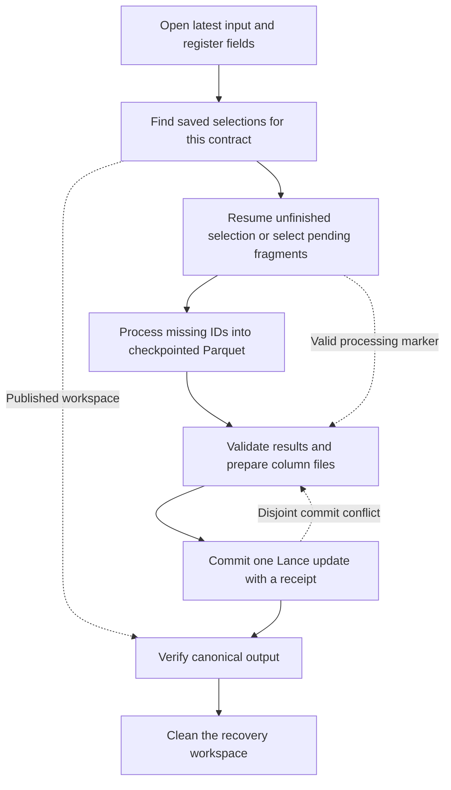

# Curator Next Checkpointing and Recovery

Curator Next separates **saving computation** from **publishing results**. Ray checkpoints track which logical IDs have
durable Parquet results; a Lance commit makes those results visible to readers. Keeping both the results and checkpoint
index until publication is verified lets a fresh driver or Ray cluster finish the run without repeating checkpointed
work.

The shared implementation currently covers whole-fragment enrichment: a recipe fills its owned columns on existing
Lance rows. Append publication, which `video-cut` and other producers need, is a planned extension; see
[Expansion across Curator Next](#expansion-across-curator-next).

## Assumptions and guarantees

These are the defaults for shared recovery. [Video-transcode](curator-next-video-transcode.md),
[video-embed](curator-next-video-embed.md), and the shared components below define the canonical recovery pattern.
Other recipes and older recovery helpers are migration candidates and retain their existing behavior until migrated.
Migrations must meet these assumptions or explicitly extend the shared contract.

- **Separate processing and publication.** Processing produces durable staged results. Publication consumes those
  results, so retrying a commit does not repeat downloads, encoding, or inference.
- **One atomic result commit.** All selected results and their receipt become visible in one Lance transaction.
  Registering nullable output fields is a separate schema commit; readers may see those fields before results are ready.
- **One writer per output field group.** The caller ensures one active writer owns each field group and its compatible
  contract namespace; its Ray workers may run in parallel. Recovery rejects multiple unfinished selections in that
  namespace. The helpers provide no writer leases.
- **Serial plans within a driver.** Construct and execute plans serially when they share a Ray `DataContext`. Only one
  checkpointed plan may be active per driver; a second checkpoint scope is rejected. Separate driver processes have
  independent contexts; the field-group ownership rule still applies.
- **Independent enrichments may overlap.** Writers to separate output columns may enrich the same fragments, and
  producers may append new complete fragments. Publication preserves their changes and leaves new fragments for a
  later invocation. Dependencies must already be ready in the selected input.
- **Recover the saved selection first.** Each invocation opens the latest Lance table and looks for an unfinished
  workspace for the same dataset and result contract before selecting new work. Recovery retains that workspace's
  fragment selection, even when new fragments have arrived. Lance version, execution tuning, and runtime credentials
  do not define compatibility.
- **Stable identities and immutable inputs.** Work IDs are globally unique, non-null, and stable across attempts.
  Existing input values, physical row layouts, data files, and referenced media remain immutable. Compaction, row deletion,
  and data-file rewrites are unsupported throughout the dataset's lifetime, including between attempts and after cleanup.
  Producers may append complete fragments, and enrichments may add column files while preserving existing file layouts.
- **Replay is expected.** Execution is at least once. Payload writes and other external side effects must tolerate
  replay, and required payloads must be durable before their result IDs are checkpointed.
- **Recovery state survives the cluster.** Results and checkpoint IDs stay together in intact shared storage.
  Retain the Lance transaction history needed for strict ambiguous-commit reconciliation and receipt-based consumers
  such as video-caption. Video-embed checks its input schema and values directly. Old driver memory and Ray lineage
  are never required.
- **Verify before accepting or cleaning up.** Require exact staged coverage and valid terminal results. A processing
  marker is only an optimization. Cleanup of a recovered workspace requires its publication receipt, an unchanged input
  file layout, and the canonical owned-column files from that validated publication.

The current enrichment publisher additionally requires **whole, undeleted physical fragments** in one Lance table.
Reference recipes require every fragment in the table to be wholly pending or wholly terminal for their owned fields;
selection rejects mixed fragments anywhere in the pinned snapshot. The shared publisher accepts an explicit subset,
and the reference recipes select all pending fragments when starting new work. Recovery resumes a saved selection as
a unit; it does not repartition staged results among newly chosen selections.

## Shared components and recipe responsibilities

The shared code lives in [`cosmos_curator.next.enrichment`](../../../cosmos_curator/next/enrichment/__init__.py).

Recipes use only these names:

| Component | Responsibility |
| --- | --- |
| [`owned_fields`, `EnrichmentSpec`, `EnrichmentBindings`](../../../cosmos_curator/next/enrichment/contracts.py) | Declare the owned outputs; describe the required input, result contract, input readiness, and terminal validation, deriving Parquet-stable staged rows; bind the spec to one invocation's table, staging root, and execution settings. |
| [`run_enrichment`, `ProcessingScope`, `summary_message`](../../../cosmos_curator/next/enrichment/execution.py) | The shared run sequence: open the recipe's validated input from its bindings, select an attempt, start the recipe's Ray runtime with its bindings when fragments are selected, run its plan unless processing already completed, and publish. The plan receives a `ProcessingScope` that reads the selection and writes staged rows. |
| [`EnrichmentExecutionConfig`](../../../cosmos_curator/next/enrichment/config.py) | Base for a recipe's `execution` settings, which the bindings carry to every shared step: storage profile, read batches, checkpoint groups, publication memory, and commit attempts. |
| [`ROW_ADDRESS_FIELDS`](../../../cosmos_curator/next/core/lance_datasource.py) | Original physical row addresses, for recipe work schemas that carry them to the staged rows. |

`run_enrichment` runs the remaining steps; recipes do not call them directly, though tests may:

| Component | Responsibility |
| --- | --- |
| [`open_enrichment_input`](../../../cosmos_curator/next/enrichment/inputs.py) | Register fields, pin the input, and validate it or reuse earlier proof. The `inputs` module also defines recovery identity, what a publication receipt proves, and pending selection. |
| [`reconcile_and_select_attempt`](../../../cosmos_curator/next/enrichment/attempts.py) | Verify and clean published workspaces, then resume saved work or select pending fragments. Returns an `EnrichmentAttempt` with a durable workspace and the run counts. |
| [`checkpointed_processing`](../../../cosmos_curator/next/enrichment/execution.py) | Own the Ray checkpoint for one plan and create its `ProcessingScope`, which reads the attempt's selection with IDs and row addresses, then validates and writes staged results in checkpoint groups. |
| [`publish_enrichment`](../../../cosmos_curator/next/enrichment/execution.py) | Prepare staged results with Ray Data, commit them atomically with shared provenance and recovery and validation evidence, verify, and remove the workspace. |
| [`commit`](../../../cosmos_curator/next/enrichment/commit.py), [`workspace`](../../../cosmos_curator/next/enrichment/workspace.py), [`transactions`](../../../cosmos_curator/next/enrichment/transactions.py) | Validate coverage, reconcile concurrent writes, and commit; manage durable recovery state; find publication evidence in retained history. |
| [`LanceFragmentDatasource`](../../../cosmos_curator/next/core/lance_datasource.py) | Read selected fragments at a pinned version with original row addresses. |
| [`installed_checkpoint`](../../../cosmos_curator/next/core/ray_checkpoints.py) | Own Ray Data's ambient checkpoint configuration for one plan; every Curator Next recipe that checkpoints installs it here. |

Each reference recipe's `bindings.py` defines `resolve_bindings(config)`, which constructs one frozen
`EnrichmentBindings` value per invocation. The spec says what the recipe produces; the bindings add where and how: the
table, the staging root, and the recipe's `execution` settings. The bindings resolve storage credentials at runtime,
derive the Ray workers' storage environment, and keep execution tuning out of workspace identity. Tests use the same
recipe binding factories as production. Transcode's `contracts.py` also defines the receipt video-caption reads.

`EnrichmentSpec` is the recipe's complete data contract. It names the logical `id_column`, the `input_fields` the recipe
requires, the nullable `output_fields` it owns, the `result_contract`, `validate_batch` for terminal results, and an
optional `validate_input` for domain readiness. The result contract holds only result-defining settings; the spec
snapshots it as JSON, and it scopes recovery compatibility and publication provenance. Both validators must depend
only on the result contract, so bind them to its values rather than to the whole config, as transcode's bindings do.
`input_fields` is the upstream schema: registration validates it, recovery protects the file
layout of every listed field, and processing reads a subset. Declare the output fields with
`owned_fields(fields, owner=..., field_set=...)`. It makes them nullable while pending and stamps `cosmos_curator.owner`
and `cosmos_curator.field_set` metadata, which registration compares exactly, so another recipe or field set cannot
claim the same columns. The owner is the recipe kind; the field set names the column group, such as an embedding
variant's vector field. The spec rejects a missing ID, duplicate names, non-nullable or overlapping output fields, names
that collide with row addresses, and outputs without one owner and field set at construction.

The spec derives `staged_schema`, the only definition of its checkpointed Parquet rows: the non-null `int64`
`fragment_id` and `row_offset` fields in `ROW_ADDRESS_FIELDS`, the ID field as declared in the input, and the output
fields in the shape Parquet reads back. Parquet names list children `element`, and Arrow cannot read back a null
`fixed_size_list`, so lists stage with `element` children and fixed-size lists stage as variable lists. Ray checkpoints
a row's ID once its Parquet file is written, so construction also rejects any other output type that would not read back
unchanged, such as `date64`. Processing receives the schema as `ProcessingScope.staged_schema` and builds staged rows in
it; recipes do not derive their own. Publication casts staged values to their canonical types and rejects rows that do
not convert. `validate_batch` always receives the ID and output columns in their canonical types, in batches of at most
1,024 rows that claim to be terminal, whether it is checking existing fragments or staged results. Processing applies it
to every staged row before Ray checkpoints the row's ID, and publication applies it again, so a checkpointed result is
always publishable. Transcode requires successful clips; embedding also accepts declared terminal media errors.

`run_enrichment` opens the input with `open_enrichment_input(bindings)`, which returns an `EnrichmentInput`: the pinned
dataset, its bindings, and its validation fingerprint. Shared validation requires globally unique, non-null IDs across
the whole pinned table, because checkpoints key on them and a fragment-local count cannot establish uniqueness. It then
runs the spec's `validate_input`: embedding requires clip URIs and positive sizes, and transcode rejects a downstream
receipt from another encoding contract or media destination.

`publish_enrichment` records the provenance other Curator Next enrichment commits also carry: the spec's owner as
`kind`, its field set as `field`, and the digest of the result contract as `contract_digest`. It also owns the recovery
receipt and input-validation evidence, and rejects recipe properties that try to replace any of these. Recipes pass
`run_enrichment` a `transaction_properties` callback only for records that another recipe reads, such as
`video_transcode.publication`; each must be a namespaced JSON record carrying `publication_version`.

Processing, resource scheduling, and configuration remain ordinary Ray Data recipe code. The shared Lance reader splits
or combines fragment row ranges into the requested number of balanced read tasks, capped by the number of selected rows.
It preserves the pinned version and physical row addresses, and workers resolve credentials from the storage profile.
Read parallelism is independent of publication fragments and checkpoint groups, and does not rely on Ray splitting
whole-fragment tasks.

## Processing and publication lifecycle



Before pinning the input, register the complete nullable output field set or validate existing fields against their
types, nullability, and ownership. Validate existing workspace manifests and their saved selections before choosing new
work. Enforce the table-wide pending-or-terminal invariant. A new selection contains only pending fragments; an
unfinished selection retains its original membership on recovery.

`run_enrichment` opens `checkpointed_processing(attempt)` and passes its `ProcessingScope` to the recipe's `process`
callback, which constructs and executes the plan. `read(columns)` returns the selection's logical IDs, the named input
columns, and original `fragment_id` and `row_offset`, so Ray filters checkpointed IDs before expensive work. It reads
only declared `input_fields`, so recovery protects every value the processing plan reads. The recipe builds its plan
from there, keeping the ID and row addresses through to `write` and emitting rows in `staged_schema`. `write` validates
every staged row against the staged schema and `validate_batch`, repartitions results into strict checkpoint groups,
writes them through the checkpoint's filesystem, and records the processing marker. A row that publication would reject
fails processing before Ray checkpoints its ID. The processing scope keys the checkpoint on the spec's ID column,
retains checkpoints, and clears the ambient configuration on every exit. Publication runs outside this scope so it can
read all staged results.

The processing scope reads `execution.lance_read_batch_size` rows per scanner batch and uses
`execution.parquet_rows_per_file` for the strict repartition and Parquet/checkpoint group size. Checkpoint groups
control how soon processing becomes durable; Lance fragments control publication alignment. These are independent sizes,
and a checkpoint group size does not bound all in-flight work that may replay after failure.

## Recovery identity and workspace

A contract namespace binds the dataset URI, declared input field IDs, result-defining settings, staged result schema,
and workspace format version. Each workspace within it records its explicit fragment IDs and the file layout of **those
selected fragments**: their physical rows and the files and column positions holding input fields. File layouts do not
hash external media. Unselected fragments and unrelated columns do not participate in selection compatibility.

The workspace path is `<staging-prefix>/<contract-namespace>/<selection-digest>/`, where the selection digest covers the
selected fragment IDs and their file layouts. The workspace's manifest digest, which also covers the namespace fields,
identifies it in publication receipts and the processing marker. Persisted manifests make unfinished selections
discoverable after appends. `reconcile_and_select_attempt` validates every discovered manifest before cleanup, rejects
partially published selections or multiple unfinished selections, and resumes one intact unfinished selection before
admitting a new one. Published selections are verified against their receipts before best-effort cleanup. A workspace
exists only for a nonempty selection. If a selection is entirely terminal but its publication proof is missing, retain
its workspace, warn, and report `cleanup_complete=false`; unrelated pending work can still proceed. A contradictory
receipt or a changed file layout remains an error.

The helper derives `pending`, every fragment whose output fields are pending, from the pinned input's values and
retained receipts. Processing and publication use the frozen `selected` fragments. The optional `max_fragments`, which
`run_enrichment` passes through, limits only a new selection, chosen in fragment-ID order; changing it never changes a
saved selection's membership. Neither reference recipe exposes this limit in its public config yet. The selected
workspace's manifest is durable before the helper returns.

| Change | Current recovery behavior |
| --- | --- |
| Execution tuning or unrelated schema/column writes | Resume the saved selection with its intact results and checkpoints. |
| Result contract, input field identities, or staged schema changes | Use a different contract namespace; canonical schema and input validation still apply. |
| Fragments appended before a new invocation | Resume an unfinished saved selection first. New fragments remain eligible for a later selection. |
| Fragments appended during an attempt | Finish the pinned selection and leave new fragments for a later run. |
| Existing rows compacted, replaced, deleted, or rebound | Unsupported by the immutable-dataset contract; a changed selected file layout fails recovery or publication and retains state. |
| This selection has already published | Verify its receipt, the unchanged input file layout, and the owned-column files before cleanup. Terminal values alone do not authorize deleting its workspace. |

| Artifact | Meaning and lifetime |
| --- | --- |
| `workspace.json` | Contract and selected-fragment manifest, atomically created or compared as equivalent JSON. A mismatch fails without changing the workspace. |
| `results/` | Parquet values and row addresses needed for publication. |
| `checkpoints/` | Ray's index of safely written result IDs. Retain it with the corresponding results. |
| `processing-complete.json` | Optional marker naming the manifest digest, written after processing succeeds, allowing publication retries to skip processing setup. |

These formats assume fresh datasets and workspaces; earlier development formats have no migration path. Future format
changes must make compatibility explicit. Shared receipt values are digests whose payloads carry their format version:
`workspace_version` in the manifest, and the shared validation version in the input fingerprint. Recipe receipts are
JSON records carrying `publication_version`. Property keys are never versioned.

## Canonical publication and concurrent writers

Workers group staged rows by original fragment and validate the schema, row count, every offset exactly once, ordered
logical IDs, terminal values, and provenance. Terminal-value validation consumes Arrow record batches of at most 1,024
rows, including vectorized embedding validation, rather than expanding entire fragments into Python row objects.
Workers prepare the owned column files and return compact descriptors to the driver; staged result batches and media
stay on workers. The driver decodes each descriptor into a `PreparedFragment` once when collecting worker output.
`publish_enrichment` supplies `commit_fragments` with a preparation callback, invoked for the pinned selection initially
and only for stale fragments on refresh. Prepared candidates survive commit retries, and receipt reconciliation precedes
refresh. Recipe authors use this shared adapter; direct callers of the lower-level commit primitive must meet the same
worker-validation contract before returning descriptors.

The driver requires exactly one descriptor per selected pending fragment and exactly the owned field IDs. Against the
latest table, it verifies the selected input field identities and file layout and requires descriptors to preserve
rows and all other columns. Unselected fragments remain outside that publication's coverage and completion checks.
All selected results become visible in one Lance `Update`; prepared files alone expose no partial results.

If a concurrent update to other columns makes descriptors stale, rebuild only those fragments from staged Parquet
against the latest version and retry. The preparation callback receives that version and the stale fragment IDs.
Unchanged descriptors remain reusable. Changed selected inputs or competing writes to the owned fields are rejected.

The commit records the workspace's manifest digest in `cosmos_curator.enrichment.publication`. Fresh publication and
recovery both prove success by checking unchanged inputs and the exact owned-column files validated during preparation.
The driver does not rescan all result values after the commit. An ambiguous response additionally requires that receipt
in a subsequent transaction. A fresh driver can recover the publication evidence from Lance transaction history; it need
not retain the original in-memory descriptors. Neither terminal values alone nor a receipt followed by a competing
overwrite proves success. Once the publication is verified, `publish_enrichment` removes the attempt's workspace.

### Reusing validation on later runs

Startup recognizes previously validated results from retained publication receipts. A receipt must describe the same
result contract and selected input file layout, update exactly the owned fields, and reference the current owned-column
files. Matching fragments need no row scan or terminal-value validation. Separate selections can supply separate
receipts; appends and unrelated column writes preserve proof for unchanged fragments. Fragments without matching
evidence, including after history pruning, fall back to scanning and validating their values.

The shared publisher records `cosmos_curator.enrichment.validated_input` from the `EnrichmentInput` returned by
`open_enrichment_input`. This fingerprint covers the entire validated input snapshot, including fragments outside the
frozen selection. An unchanged input can reuse the shared ID check and the spec's `validate_input`. Appends or a changed
input file layout require those checks again across the complete table, so duplicates between old and new fragments
remain detectable. Appends arriving during publication are excluded from the fingerprint, which describes the original
validated snapshot. Neither the fingerprint nor publication receipts cover validator code: a recipe that changes what
`validate_input` or `validate_batch` accepts must change its result contract so earlier evidence is not reused.

An unchanged rerun with retained evidence reads metadata and transaction history rather than table rows. Startup cost
still depends on fragment and retained-history counts. Workers validate staged values before first publication; exact
file-layout checks then prove that the canonical output uses those validated files. Missing publication evidence still
requires scanning terminal values. None of these checks requires an upstream producer's receipt.

### Publication sizing

`execution.publication_memory_gib` reserves memory for each recipe's fragment preparation task. This is scheduling
accounting, not a process memory limit. Fragment grouping and sorting still materialize a whole fragment, and Lance
column preparation retains fragment-sized data. Bounded validation batches do not make the complete publisher streaming.
Select fragment sizes that fit worker memory; this implementation does not establish million-row-fragment or
billion-row-table qualification. Logical checkpoint IDs remain strings, and native Ray checkpoint loading still depends
on the size of the entire selected run's checkpoint index.

## Failure and recovery boundaries

| Interruption or invalid state | Recovery behavior |
| --- | --- |
| Processing or a Parquet write is interrupted | Ray reconciles pending/committed writes and replays uncheckpointed work. |
| Results are checkpointed but Lance has not committed | Rebuild publication from staged Parquet; prepared column files can be regenerated. |
| Processing marker is missing, unreadable, malformed, or incompatible | Resume through native checkpoints. Marker write failure is only a warning. |
| Staged rows are missing, duplicated, misaligned, or invalid | Processing rejects invalid values before checkpointing their IDs. Publication fails validation and retains recovery state, even if a completion marker exists. |
| Lance committed but its response was lost | Reconcile the receipt and canonical results before accepting success. |
| Driver exits after commit or cleanup fails | A fresh invocation discovers the saved selection and verifies its publication receipt, the unchanged input file layout, and the owned-column files before retrying cleanup. |
| A saved selection is terminal but publication proof is missing | Retain the workspace, warn, report `cleanup_complete=false`, and allow unrelated work to proceed. |
| Saved inputs, receipt coverage, or owned-column files contradict the workspace | Fail and retain recovery state; these mismatches are not cleanup warnings. |
| New input fragments arrive between attempts | Recover the prior unfinished selection; do not fold its staged results into a new selection. |

Conflicting recovery state raises `RecoveryStateError`, a `ValueError` naming each workspace involved and how to resolve
it. Cleanup is best effort and reported as `cleanup_complete`; failure does not invalidate published results. An
incompatible or unverifiable workspace is retained. Other contract namespaces and uncommitted column files need separate cleanup.
Tolerating missing proof applies only to cleanup of already-terminal selections. It does not relax publication
reconciliation or video-caption's transcode-provenance checks.

## Run summaries

`run_enrichment` returns the `EnrichmentOutcome` from `publish_enrichment`, whose `summary()` reports the shared
vocabulary. Recipes add their own fields, such as the published table as `<table>_lance_uri` and
`<table>_lance_version`, following other Curator Next recipes:

| Field | Meaning |
| --- | --- |
| `input_rows` | All rows in the invocation's pinned input. |
| `selected_rows` | Rows in the frozen selection published by this invocation, including results recovered from checkpoints. |
| `remaining_rows` | Rows still pending from the pinned input after publication. |
| `selected_fragments` | Fragments in the frozen selection. |
| `remaining_fragments` | Fragments still pending from the pinned input after publication. |
| `cleanup_complete` | Whether this invocation cleaned every eligible recovery workspace. |
| `field_set` | The output field set, also recorded as the publication's `field`. |
| `contract_digest` | Digest of the result contract, also recorded as the publication's `contract_digest`. |

Counts exclude later appends. Already-terminal rows are included in `input_rows` but neither `selected_rows` nor
`remaining_rows`. A completed rerun selects zero rows. Selected rows include declared terminal errors where the recipe
allows them; the count does not claim fresh inference or successful media processing for every selected row.
`summary_message` renders the CLI message from the selected row count and remaining fragments; logs include the
complete structured summary.

## Adopting the reference pattern

Use `video_embed` as the example for independent row processing and terminal media errors; use `video_transcode` for
source grouping and payload writes that must finish before checkpointing. Both follow this sequence, sketched here for
an item-scoring recipe: the item schema, `validate_items`, `validate_scores`, and the Ray Data plan are recipe-owned.
Put `resolve_bindings` in the recipe's `bindings.py` and base its `execution` config on `EnrichmentExecutionConfig`.

```python
from functools import partial

import pyarrow as pa

from cosmos_curator.next.enrichment.contracts import EnrichmentBindings, EnrichmentSpec, owned_fields
from cosmos_curator.next.enrichment.execution import ProcessingScope, run_enrichment

SCORE_FIELDS = owned_fields(pa.schema([("score", pa.float32())]), owner="item-score", field_set="score_v1")
READ_COLUMNS = ("uri",)  # Read besides item_id and row addresses.


def resolve_bindings(config: ResolvedConfig) -> EnrichmentBindings:
    revision = config.model.revision
    return EnrichmentBindings(
        uri=config.input.items_lance_uri,
        spec=EnrichmentSpec(
            id_column="item_id",
            input_fields=ITEM_SCHEMA,  # The upstream schema this recipe requires.
            output_fields=SCORE_FIELDS,
            result_contract={"scorer_revision": revision},  # Result-defining settings only.
            validate_batch=partial(validate_scores, revision=revision),  # Reject any row that is not terminal.
            validate_input=validate_items,  # Optional readiness of the whole pinned table.
        ),
        staging_root=config.output.staging_root_uri,
        execution=config.execution,
    )


def start_ray(bindings: EnrichmentBindings, config: ResolvedConfig) -> None:
    # The bindings add the table and staging root; list the recipe's other locations.
    ensure_ray_initialized(runtime_env_vars=bindings.storage_env_vars(config.input.media_root), ...)


def process(processing: ProcessingScope, config: ResolvedConfig) -> None:
    rows = processing.read(READ_COLUMNS)
    results = rows.map(...).map_batches(score_items, fn_kwargs={"staged_schema": processing.staged_schema})
    processing.write(results)


def run_config(config: ResolvedConfig) -> dict[str, object]:
    outcome = run_enrichment(
        resolve_bindings(config),
        start_ray=partial(start_ray, config=config),
        process=partial(process, config=config),
    )
    return {
        **outcome.summary(),
        "items_lance_uri": config.input.items_lance_uri,
        "items_lance_version": int(outcome.dataset.version),
    }
```

`run_enrichment` starts Ray whenever fragments are selected, even when a valid processing marker skips `process`,
because publication prepares column files with Ray Data; preparation refuses to start a default Ray runtime itself.
An attempt without selected fragments starts no Ray and publishes nothing, and its outcome still reports cleanup status.
The shared publisher owns result grouping, preparation retries, receipts, proof verification, and workspace cleanup.

Preserve deliberate differences: transcode's actors bound admission of large source downloads, while embed uses tasks
for clips. Transcode requires successful payloads; embed permits declared terminal errors. Transcode passes
`transaction_properties` for its receipt record and commits a zero-span receipt for an empty table itself
(`record_empty_receipt`), because video-caption reads transcode's whole-table receipt. Recording that receipt twice is
harmless, so it needs no recovery workspace. Remove both once caption checks clip readiness from data, as embedding
does.

## Expansion across Curator Next

Migration should remove accidental differences, not turn them into recipe-specific switches. Compare compatibility
scope, work selection, and publication granularity, then choose shared behavior deliberately. Keep differences justified
by data contracts or measured performance, and document any changed guarantees for existing consumers.

The current publisher supports selections of whole fragments and recovery of their unchanged inputs. `run_enrichment`
accepts `max_fragments`, but public recipe selection-size limits and upstream readiness checks per fragment remain
follow-up work. Video-embed validates clip readiness across the entire pinned table using schema and data checks,
without an upstream publication receipt. Appending rows as a publication operation, updating selected rows within a
fragment, publishing multiple datasets or several field sets in one commit, coordinating writers to the same fields, or
regrouping unfinished work across selections require explicit extensions.

Check these before migrating a recipe. Embeddings and robot-action-caption select rows within fragments and checkpoint
on row addresses, and multimodal-embedding publishes per-camera field sets in one commit; each needs an extension first.
Video-caption's whole-fragment, `clip_id`-checkpointed enrichment is the closest fit. The append-oriented
[`lance_fragment_recovery`](../../../cosmos_curator/next/utils/lance_fragment_recovery.py) is deprecated for new
workflows. Extend shared publication to cover appends and migrate existing producers before retiring it. Shared APIs and
package paths remain provisional during incubation.

## Validation and adoption criteria

Shared tests cover [checkpoint isolation](../../../tests/cosmos_curator/next/core/test_ray_checkpoints.py),
[workspaces](../../../tests/cosmos_curator/next/enrichment/test_workspace.py),
[pending selection and publication evidence](../../../tests/cosmos_curator/next/enrichment/test_inputs.py),
[attempt selection](../../../tests/cosmos_curator/next/enrichment/test_attempts.py), and
[publication invariants](../../../tests/cosmos_curator/next/enrichment/test_commit.py).

Each adopting recipe runs the [conformance suite](../../../tests/cosmos_curator/next/enrichment/conformance.py) against
its own data; the suite's module docstring lists the fixtures a recipe supplies. It drives the recipe's `run_config`
without Ray and exercises publication, misaligned and missing results, concurrent writers, lost commit responses,
appends, workspace identity, reruns, processing markers, incompatible workspaces, and cleanup failures. Recipe tests
then cover only recipe-specific behavior.

Each adopting recipe also runs the
[fresh-cluster scenario](../../../tests/cosmos_curator/next/enrichment/fresh_cluster.py) from an integration test,
supplying stand-ins for its expensive stages that record the IDs they process. On real Ray, the scenario interrupts
processing after the first selected fragment, then resumes on a fresh cluster after a disjoint column write and
execution retuning, and requires each expensive step to run exactly once per ID. Finally, it runs the recipe's own
`run_config`, which must reprocess nothing, publish once, and remove the workspace. The
[transcode](../../../tests/cosmos_curator/next/recipes/video_transcode/test_ray_checkpoint.py) and
[embedding](../../../tests/cosmos_curator/next/recipes/video_embed/test_ray_pipeline.py) tests show the stand-ins.

Each migration must document how it satisfies the [assumptions above](#assumptions-and-guarantees) and demonstrate that
clean and resumed runs produce the same visible logical records and payload references. Exercise the failure boundaries,
compatible and incompatible workspace changes, and concurrent disjoint writes. Changes to the shared contract must be
documented and tested for both new and existing consumers.

The scenario verifies native checkpointing against the supported Ray version and the recipe's complete plan; the helper
alone cannot establish that the plan is checkpointable. Real Ray execution belongs in integration tests, with GPU/model
tests as needed.

Managed Ray qualification additionally requires late workers, worker loss including a period with no workers, and a
fresh head and driver. The [transcode](curator-next-video-transcode.md#failure-policy-and-validation) and
[embedding](curator-next-video-embed.md#configuration-and-validation) designs record their coverage; using the shared
helpers does not confer that qualification.
