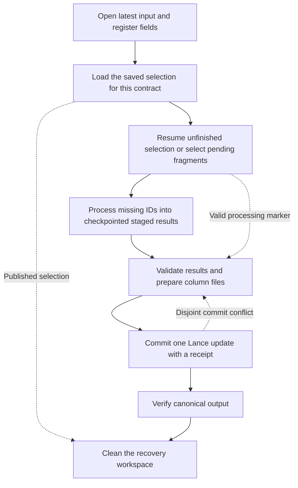

# Curator Next Checkpointing and Recovery

Curator Next separates **saving computation** from **publishing results**. Ray checkpoints track which logical IDs have
durable staged results; a Lance commit makes those results visible to readers. Keeping both the results and checkpoint
index until publication is verified lets a fresh driver or Ray cluster finish the run without repeating checkpointed
work.

The shared implementation covers two kinds of publication. **Enrichment** fills a recipe's owned columns on existing
Lance rows, one whole fragment at a time; `video-transcode` and `video-embed` use it. **Append** adds a producer's rows
to a Lance table it owns; `video-cut` uses it. [The shared model](#the-shared-model) describes what both kinds share:
assumptions, run sequence, workspaces, failure handling, and summaries. [Enrichment
publication](#enrichment-publication) and [append publication](#append-publication) each describe only what their kind
adds, including an adoption example. Other recipes migrate explicitly; see
[Expansion across Curator Next](#expansion-across-curator-next).

## Assumptions and guarantees

These are the defaults for shared recovery. [Video-transcode](curator-next-video-transcode.md),
[video-embed](curator-next-video-embed.md), [video-cut](curator-next-video-cut.md), and the shared components below
define the canonical recovery pattern. Other recipes and older recovery helpers are migration candidates and retain
their existing behavior until migrated. Migrations must meet these assumptions or explicitly extend the shared contract.

- **Separate processing and publication.** Processing produces durable staged results. Publication consumes those
  results, so retrying a commit does not repeat downloads, encoding, or inference.
- **One atomic result commit.** All selected results become visible in one Lance transaction.
  Registering nullable output fields, or creating an appended table, is a separate schema commit; readers may see those
  fields or the empty table before results are ready.
- **One writer per output field group.** The caller ensures one active writer owns each field group, or each appended
  table, and its contract's fixed workspace; its Ray workers may run in parallel. The helpers provide no writer leases.
- **Serial plans within a driver.** Construct and execute plans serially when they share a Ray `DataContext`. Only one
  checkpointed plan may be active per driver; a second checkpoint scope is rejected. Separate driver processes have
  independent contexts; the field-group ownership rule still applies.
- **Independent enrichments may overlap.** Writers to separate output columns may enrich the same fragments, and
  producers may append new complete fragments. Publication preserves their changes and leaves new fragments for a
  later invocation. Dependencies must already be ready in the selected input.
- **Recover the saved selection first.** Each invocation opens the latest Lance table and looks for an unfinished
  workspace for the same dataset and result contract before selecting new work. Recovery retains that workspace's
  selection of fragments or work items, even when new fragments have arrived or discovery finds other items. Lance
  version, execution tuning, and runtime credentials do not define compatibility.
- **Stable identities and immutable inputs.** Work IDs are globally unique, non-null, and stable across attempts.
  Existing input values, physical row layouts, data files, discovered sources, and referenced media remain immutable.
  Source storage is stable too: objects do not appear, disappear, or change permissions or storage class between
  attempts, so a source that is unreadable as stored stays unreadable.
  Compaction, row deletion, and data-file rewrites are unsupported throughout the dataset's lifetime, including between
  attempts and after cleanup. Producers may append complete fragments, and enrichments may add column files while
  preserving existing file layouts.
- **Replay is expected.** Execution is at least once. Payload writes and other external side effects must tolerate
  replay, and required payloads must be durable before their result IDs are checkpointed.
- **Recovery state survives the cluster.** Results and checkpoint IDs stay together in intact shared storage.
  Enrichment retains the Lance transaction history needed for strict ambiguous-commit reconciliation. Recovery and
  cleanup read current rows and values, so pruned history never blocks them. Video-caption and video-embed check their
  input schema and values directly. Old driver memory and Ray lineage are never required.
- **Verify before accepting or cleaning up.** Require exact staged coverage and valid terminal results. A processing
  marker is only an optimization. Before cleanup, enrichment verifies that every selected fragment is terminal and its
  input file layout unchanged; append verifies that every selected item is present in the current table.

## The shared model

### Shared components

Both kinds build on these recipe-agnostic pieces in `cosmos_curator.next.core`:

| Component | Responsibility |
| --- | --- |
| [`RecoveryWorkspace`, `RecoveryStateError`, `checkpoint_writer`](../../../cosmos_curator/next/core/recovery_workspace.py) | Durable recovery state: the manifest, staged results, native checkpoints, and processing marker of one selection; direct loading of the saved selection and `resume_or_clear`, which resumes it or clears it once fully published; best-effort cleanup. `checkpoint_writer` installs one plan's Ray checkpoint and yields the writer that validates, stages, and checkpoints its results, then records the marker. |
| [`installed_checkpoint`, `StagedResultsDatasink`, `read_staged_results`, `VALIDATION_BATCH_SIZE`](../../../cosmos_curator/next/core/ray_checkpoints.py) | Own Ray Data's ambient checkpoint configuration for one plan, write and read staged Arrow IPC files with Ray Data or plain Arrow, and bound terminal-validation batches. |
| [`find_transaction`, `iter_transactions`, `KIND_KEY`, `CONTRACT_DIGEST_KEY`](../../../cosmos_curator/next/core/lance_transactions.py) | Find publication evidence in the retained history of a pinned Lance snapshot; name the provenance every shared publication records. |
| [`RecoveryBindings`](../../../cosmos_curator/next/core/recovery_bindings.py) | Resolve a binding's storage credentials and Ray worker storage environment at runtime. |
| [`CheckpointedExecutionConfig`](../../../cosmos_curator/next/core/config.py) | Execution settings both kinds share: storage profile, checkpoint group size (`rows_per_checkpoint`), commit attempts, and progress reporting. |

Recipes use the API of their kind's package, [`enrichment`](../../../cosmos_curator/next/enrichment/__init__.py) or
[`append`](../../../cosmos_curator/next/append/__init__.py), whose docstring lists it. Each package has the same
shape: `contracts` (the spec and bindings), `config` (the execution base), `inputs` (opening the table, pending work,
and recovery identity), `attempts` (reconciling workspaces and selecting work), `execution` (the run sequence,
processing scope, and publisher), and `commit` (the Lance protocol).

### Specs, bindings, and the run sequence

A recipe describes what it produces in a spec, `EnrichmentSpec` or `AppendSpec`: the logical ID column, the result
contract, and `validate_batch` for terminal results. The result contract holds only result-defining settings; the
spec snapshots it as JSON, and it scopes recovery compatibility and publication provenance. Validators, and append's
expansion, must depend only on the result contract: tables and workspaces are keyed by it, not by code, so a recipe
that changes what they accept or produce must change its result contract.

Bindings, `EnrichmentBindings` or `AppendBindings`, bind the spec to one invocation's table URI, staging root, and
`execution` settings. Each reference recipe's `bindings.py` defines `resolve_bindings(config)`, which constructs one
frozen bindings value per invocation; tests use the same factories as production. Storage credentials are resolved at
runtime from `execution.storage_profile`, and execution tuning never enters recovery identity.

`run_enrichment` and `run_append` run the same sequence:

1. Open the table, reconcile saved workspaces, and resume or select an attempt. Append recipes call their discovery
   callback only when selecting new work; a saved selection already contains its items.
2. When work is selected, call the recipe's `start_ray(bindings)`. It runs even when a valid processing marker skips
   processing, because publication prepares results with Ray Data and refuses to start a default Ray runtime itself.
   `bindings.storage_env_vars(...)` covers the table and staging root; recipes pass their other locations.
3. Unless the marker is valid, open `checkpointed_processing(attempt)` and call the recipe's `process(scope)`, which
   builds and executes one plan from `scope.read` to `scope.write`. Put model preflight and other processing
   prerequisites inside `process`.
4. Publish atomically, verify, and remove the workspace. An attempt with nothing selected
   starts no Ray and publishes nothing; its outcome still reports cleanup status.

The `ProcessingScope` reads the frozen selection at Ray's native checkpoint-filter boundary, so checkpointed IDs are
skipped before expensive work. Recipes keep the ID through the plan and emit canonical results in
`scope.result_schema`. `scope.write` delegates to the core checkpoint writer, which repartitions results into strict
groups of `execution.rows_per_checkpoint` rows, validates every row as publication would, writes each group as one
staged file through the checkpoint's filesystem, and records the processing marker. Validation runs after the
repartition with default remote args, so Ray fuses it into each group's write task rather than adding a task per plan
block. A row that publication would reject fails processing before Ray checkpoints its ID. The scope keys the
checkpoint on the spec's ID column, retains checkpoints, and clears the ambient configuration on every exit.
Publication runs outside this scope so it can read all staged results.

Staged files are zstd-compressed Arrow IPC files. IPC is Arrow's own serialization, so staged rows keep their canonical
schema exactly: nested and fixed-size lists with null rows or elements, list child names, `date64`, and all metadata
read back unchanged, and publication needs no storage conversion. Ray applies its two-phase checkpointed write to file
sinks, recording a pending checkpoint before each file and committing it afterward, so a staged file and its
checkpointed IDs stay consistent. Ray's own checkpoint ID files remain Parquet.

`validate_batch` always receives the ID and result columns in their canonical types, in batches of at most
`VALIDATION_BATCH_SIZE` (1,024) rows that claim to be terminal. Processing applies it to every staged row before Ray
checkpoints the row's ID, and publication applies it again, so a checkpointed result is always publishable.

Checkpoint groups control how soon processing becomes durable; publication fragments control storage layout. These
are independent sizes, and a checkpoint group size does not bound all in-flight work that may replay after failure.
Processing, resource scheduling, and configuration otherwise remain ordinary Ray Data recipe code.

### Recovery workspaces and receipts

A contract namespace binds the table identity, the spec's schemas and result contract, and the workspace format
version; each kind adds its own input identity. Both kinds reuse one fixed workspace at
`<staging-prefix>/<contract-namespace>/`. Persisted manifests retain unfinished selections after the table changes. The
manifest digest identifies the selection in its processing marker and, for enrichment, the publication receipt. Both
kinds record the owner as `kind` and result contract digest as `contract_digest`; append carries completion and errors
in current rows.

| Artifact | Meaning and lifetime |
| --- | --- |
| `workspace.json` | Contract and selection manifest, atomically created or compared as equivalent JSON. A mismatch fails without changing the workspace. |
| `results/` | Staged Arrow IPC results needed for publication. |
| `checkpoints/` | Ray's index of safely written result IDs. Retain it with the corresponding results. |
| `processing-complete.json` | Optional marker naming the manifest digest, written after processing succeeds, allowing publication retries to skip processing setup. |

`reconcile_and_select_attempt` reads the one saved manifest directly, validates it, and resumes an intact unfinished
selection before admitting a new one. A published selection is verified against current rows or values, and its
workspace must be cleaned before a new selection can reuse the path. A new selection first clears any files left by
interrupted cleanup. A workspace is created only for a nonempty selection, and its manifest is
durable before processing starts. A partly published selection, an invalid manifest, or changed selected input
remains an error.

Selection limits, `execution.max_fragments` for enrichment and `execution.max_items` for append, bound only a new
selection, in ID order, and never change a saved selection's membership. Both default to `None`, which selects all
pending work. Set a limit to make results visible sooner through smaller selections. For append, a limit also bounds
the driver's per-item read tasks and manifest entries; a million video-cut items take about 1 GB of driver memory and
a 170 MB manifest. With a limit, or after resuming a saved selection, rerun while the summary reports remaining or
unknown work.

These formats assume fresh datasets and workspaces; earlier development formats have no migration path. Future format
changes must make compatibility explicit. Shared receipt values are digests whose payloads carry their format version,
such as `workspace_version` in the manifest. Property keys are never versioned.

### Failure and recovery boundaries

| Interruption or invalid state | Recovery behavior |
| --- | --- |
| Processing or a staged-file write is interrupted | Ray reconciles pending/committed writes and replays uncheckpointed work. |
| Results are checkpointed but Lance has not committed | Rebuild publication from staged results; prepared or staged Lance files can be regenerated. |
| Processing marker is missing, unreadable, malformed, or incompatible | Resume through native checkpoints. Marker write failure is only a warning. |
| Staged results are missing, duplicated, or invalid | Processing rejects invalid values before checkpointing their IDs. Publication fails validation and retains recovery state, even if a completion marker exists. |
| Lance committed but its response was lost | Verify the canonical files, plus the receipt for enrichment, before accepting success; results are not published twice. |
| Driver exits after commit or cleanup fails | A fresh invocation verifies the saved selection against current rows (append) or terminal values and unchanged inputs (enrichment), then retries cleanup. |
| Workspace cleanup still fails on the next invocation | Raise an error and defer new work until cleanup succeeds. Published results remain valid. |
| History pruning removed a publication receipt | Current rows and values still prove completion; enrichment validates those fragments' values instead of skipping the scan. |
| Saved inputs changed, or only part of a saved selection is published | Fail and retain recovery state; these mismatches are not cleanup warnings. |
| New input arrives between attempts | Recover the prior unfinished selection; do not fold its staged results into a new selection. |

Conflicting recovery state raises `RecoveryStateError`, a `ValueError` naming the workspace involved and how to resolve
it. Cleanup after publication is best effort and reported as `cleanup_complete`; failure does not invalidate published
results, but the next selection waits until cleanup succeeds. An incompatible workspace is retained. Other contract
namespaces and uncommitted Lance files need separate cleanup.

### Run summaries

`run_enrichment` and `run_append` return an outcome whose `summary()` reports the shared vocabulary; `summary_message`
in each kind's `execution` module renders the one-line CLI result. Recipes add their own fields, such as the published
table as `<table>_lance_uri` and `<table>_lance_version`.

| Field | Kind | Meaning |
| --- | --- | --- |
| `cleanup_complete` | Both | Whether this invocation cleaned its workspace. |
| `contract_digest` | Both | Digest of the result contract, also recorded as the publication's `contract_digest`. |
| `input_rows` | Enrichment | All rows in the invocation's pinned input. |
| `selected_rows`, `selected_fragments` | Enrichment | Rows and fragments in the frozen selection this invocation published, including results recovered from checkpoints. |
| `remaining_rows`, `remaining_fragments` | Enrichment | Rows and fragments still pending from the pinned input after publication. |
| `field_set` | Enrichment | The output field set, also recorded as the publication's `field`. |
| `input_items` | Append | The work items this invocation discovered, or null when resuming without discovery. |
| `selected_items` | Append | Items in the frozen selection this invocation published, including recovered results, empty outcomes, and terminal errors. |
| `remaining_items` | Append | Discovered items still pending, or null when resuming without discovery. Rerun to discover new work. |
| `appended_rows` | Append | Rows the selection appended, including empty/error outcomes. |
| `errors` | Append | Number of selected items with a terminal error; diagnostics remain in the table. |

Enrichment counts describe physical rows in fragments, including any null-ID outcome rows skipped by processing.
Counts exclude later appends. A completed rerun selects nothing. Selected counts include declared terminal errors
where the recipe allows them; they do not claim fresh inference or successful media processing for every selected row
or item. Logs include the complete structured summary.

## Enrichment publication

Enrichment fills a recipe's owned nullable columns on existing rows of one Lance table, one whole fragment at a time.
Recipes use `owned_fields`, `EnrichmentSpec`, and `EnrichmentBindings` from
[`contracts`](../../../cosmos_curator/next/enrichment/contracts.py); `run_enrichment`, `ProcessingScope`, and
`summary_message` from [`execution`](../../../cosmos_curator/next/enrichment/execution.py);
[`EnrichmentExecutionConfig`](../../../cosmos_curator/next/enrichment/config.py), which adds the selection limit
(`max_fragments`), read batches (`lance_read_batch_size`), and publication memory to the shared settings; and
[`ROW_ADDRESS_FIELDS`](../../../cosmos_curator/next/core/lance_datasource.py) for work schemas that carry row
addresses. `run_enrichment` runs the remaining steps, which recipes do not call directly, though tests may:

| Component | Responsibility |
| --- | --- |
| [`open_enrichment_input`](../../../cosmos_curator/next/enrichment/inputs.py) | Register fields, pin the input, and validate it or reuse earlier proof. The `inputs` module also defines recovery identity, what a publication receipt proves, and pending selection. |
| [`reconcile_and_select_attempt`](../../../cosmos_curator/next/enrichment/attempts.py) | Resume saved work, or clean a published selection's workspace and select pending fragments. Returns an `EnrichmentAttempt` with a durable workspace and the run counts. |
| [`checkpointed_processing`](../../../cosmos_curator/next/enrichment/execution.py) | Create the `ProcessingScope`, which reads the attempt's selection with IDs and row addresses and writes through the core checkpoint writer. |
| [`publish_enrichment`](../../../cosmos_curator/next/enrichment/execution.py) | Prepare staged results with Ray Data, commit them atomically with shared provenance and recovery and validation evidence, verify, and remove the workspace. |
| [`commit`](../../../cosmos_curator/next/enrichment/commit.py) | Validate coverage, reconcile concurrent writes, and commit. |
| [`LanceFragmentDatasource`](../../../cosmos_curator/next/core/lance_datasource.py) | Read selected fragments at a pinned version with original row addresses. |

The current publisher requires **whole, undeleted physical fragments** in one Lance table. Reference recipes require
every fragment in the table to be wholly pending or wholly terminal for their owned fields; selection rejects mixed
fragments anywhere in the pinned snapshot. The shared publisher accepts an explicit subset, and the reference recipes
select all pending fragments when starting new work unless `execution.max_fragments` bounds it. Recovery resumes a
saved selection as a unit; it does not repartition staged results among newly chosen selections. Cleanup of a
recovered workspace additionally requires an unchanged input file layout and terminal output in every selected
fragment.

### Enrichment contract

`EnrichmentSpec` names the logical `id_column`, the `input_fields` the recipe requires, the nullable `output_fields` it
owns, the `result_contract`, `validate_batch`, and an optional `validate_input` for domain readiness. Bind both
validators to the result contract's values rather than to the whole config, as transcode's bindings do.
`input_fields` is the upstream schema: registration validates it, recovery protects the file layout of every listed
field, and processing reads a subset. Declare the output fields with `owned_fields(fields, owner=..., field_set=...)`.
It makes them nullable while pending and stamps `cosmos_curator.owner` and `cosmos_curator.field_set` metadata, which
registration compares exactly, so another recipe or field set cannot claim the same columns. The owner is the recipe
kind; the field set names the column group, such as an embedding variant's vector field. The spec rejects a missing
ID, duplicate names, non-nullable or overlapping output fields, names that collide with row addresses, and outputs
without one owner and field set at construction.

The spec derives `result_schema` for canonical processing results: the non-null `int64` `fragment_id` and
`row_offset` fields in `ROW_ADDRESS_FIELDS`, the non-null ID field, and the owned output fields.
`ProcessingScope.read(columns)` returns the selection's logical IDs, the named input columns, and the original row
addresses; it reads only declared `input_fields`, so recovery protects every value the plan reads. The recipe keeps the
ID and row addresses through to `write`. `validate_batch` receives the ID and output columns, whether it is checking
existing fragments or staged results. Transcode requires successful clips; embedding also accepts declared terminal
media errors.

`run_enrichment` opens the input with `open_enrichment_input(bindings)`, which returns an `EnrichmentInput`: the pinned
dataset, its bindings, and its validation fingerprint. Shared validation requires globally unique work IDs across
the pinned table, because checkpoints key on them and a fragment-local count cannot establish uniqueness. A null ID
marks a row outside the work set, such as a source outcome in video-cut's span table. Validation then runs the spec's
optional `validate_input`: embedding requires clip URIs and positive sizes. Transcode's terminal-value validator checks
the encoding contract and media destination of completed clips when classifying fragments.

`publish_enrichment` records the shared `kind` and `contract_digest` provenance plus the spec's field set as `field`.
It also owns the recovery receipt, `cosmos_curator.enrichment.publication`, and input-validation evidence. Consumers
determine upstream readiness from the current schema and values; recipes need no separate completion records.

The shared Lance reader splits or combines fragment row ranges into the requested number of balanced read tasks, capped
by the number of selected rows. It preserves the pinned version and physical row addresses, and workers resolve
credentials from the storage profile. `execution.lance_read_batch_size` sets the rows per scanner batch. Read
parallelism is independent of publication fragments and checkpoint groups, and does not rely on Ray splitting
whole-fragment tasks.



### Enrichment recovery identity

The contract namespace binds the dataset URI, declared input field IDs, result-defining settings, result schema, and
workspace format version. Workspace format 6 isolates earlier layouts, including Parquet staging. The fixed workspace's manifest records the
selection's explicit fragment IDs and the file layout of **those selected fragments**: their physical rows and the files
and column positions holding input fields. File layouts do not hash external media. Unselected fragments and unrelated
columns do not participate in selection compatibility.

Before pinning the input, register the complete nullable output field set or validate existing fields against their
types, nullability, and ownership. Then enforce the table-wide pending-or-terminal invariant. The helper derives
`pending`, every fragment whose output fields are pending, from the pinned input's values and retained receipts.
Processing and publication use the frozen `selected` fragments.

| Change | Current recovery behavior |
| --- | --- |
| Execution tuning or unrelated schema/column writes | Resume the saved selection with its intact results and checkpoints. |
| Result contract, input field identities, or result schema changes | Use a different contract namespace; canonical schema and input validation still apply. |
| Fragments appended before a new invocation | Resume an unfinished saved selection first. New fragments remain eligible for a later selection. |
| Fragments appended during an attempt | Finish the pinned selection and leave new fragments for a later run. |
| Existing rows compacted, replaced, deleted, or rebound | Unsupported by the immutable-dataset contract; a changed selected file layout fails recovery or publication and retains state. |
| This selection has already published | Require the unchanged input file layout and terminal output in every selected fragment, from a matching receipt or validated values, then remove the workspace before selecting new work. |

### Canonical publication and concurrent writers

Workers group staged rows by original fragment and validate the schema, row count, every offset exactly once, ordered
logical IDs, terminal values, and provenance. Terminal-value validation consumes Arrow record batches of at most 1,024
rows, including vectorized embedding validation, rather than expanding entire fragments into Python row objects.
Workers prepare the owned column files and return compact descriptors to the driver; staged result batches and media
stay on workers. The driver decodes each descriptor into a `PreparedFragment` once when collecting worker output.
`publish_enrichment` supplies `commit_fragments` with a preparation callback, invoked for the pinned selection initially
and only for stale fragments on refresh. Prepared candidates survive commit retries, and receipt reconciliation precedes
refresh. Recipe authors use this shared adapter; direct callers of the lower-level commit primitive must meet the same
worker-validation contract before returning descriptors.

The driver requires exactly one descriptor per selected pending fragment and exactly the owned field IDs. Against the
latest table, it verifies the selected input field identities and file layout and requires descriptors to preserve
rows and all other columns. Unselected fragments remain outside that publication's coverage and completion checks.
All selected results become visible in one Lance `Update`; prepared files alone expose no partial results.

If a concurrent update to other columns makes descriptors stale, rebuild only those fragments from staged results
against the latest version and retry. The preparation callback receives that version and the stale fragment IDs.
Unchanged descriptors remain reusable. Changed selected inputs or competing writes to the owned fields are rejected.

Publication proves success by checking unchanged inputs and the exact owned-column files validated during preparation.
The driver does not rescan all result values after the commit. An ambiguous response additionally requires the receipt
in a subsequent transaction; a receipt followed by a competing overwrite does not prove success. After a driver exits,
the next invocation recognizes the publication from current output, as pending selection does, without the original
in-memory descriptors.

### Reusing validation on later runs

Startup recognizes previously validated results from retained publication receipts. A receipt must describe the same
result contract and selected input file layout, update exactly the owned fields, and reference the current owned-column
files. Matching fragments need no row scan or terminal-value validation. Separate selections can supply separate
receipts; appends and unrelated column writes preserve proof for unchanged fragments. Fragments without matching
evidence, including after history pruning, fall back to scanning and validating their values.

The shared publisher records `cosmos_curator.enrichment.validated_input` from the `EnrichmentInput` returned by
`open_enrichment_input`. This fingerprint covers the entire validated input snapshot, including fragments outside the
frozen selection. An unchanged input can reuse the shared ID check and the spec's `validate_input`. Appends or a changed
input file layout require those checks again across the complete table, so duplicates between old and new fragments
remain detectable. Appends arriving during publication are excluded from the fingerprint, which describes the original
validated snapshot. Neither the fingerprint nor publication receipts cover validator code: a recipe that changes what
`validate_input` or `validate_batch` accepts must change its result contract so earlier evidence is not reused.

An unchanged rerun with retained evidence reads metadata and transaction history rather than table rows. Startup cost
still depends on fragment and retained-history counts. Workers validate staged values before first publication; exact
file-layout checks then prove that the canonical output uses those validated files. Missing publication evidence still
requires scanning terminal values. None of these checks requires an upstream producer's receipt.

### Publication sizing

`execution.publication_memory_gib` reserves memory for each recipe's fragment preparation task. This is scheduling
accounting, not a process memory limit. Fragment grouping and sorting still materialize a whole fragment, and Lance
column preparation retains fragment-sized data. Bounded validation batches do not make the complete publisher streaming.
Select fragment sizes that fit worker memory; this implementation does not establish million-row-fragment or
billion-row-table qualification. Logical checkpoint IDs remain strings, and native Ray checkpoint loading still depends
on the size of the entire selected run's checkpoint index.

### Adopting enrichment publication

Use `video_embed` as the example for independent row processing and terminal media errors; use `video_transcode` for
source grouping and payload writes that must finish before checkpointing. Both follow this sequence, sketched here for
an item-scoring recipe: the item schema, `validate_items`, `validate_scores`, and the Ray Data plan are recipe-owned.
Put `resolve_bindings` in the recipe's `bindings.py` and base its `execution` config on `EnrichmentExecutionConfig`.

```python
from functools import partial

import pyarrow as pa

from cosmos_curator.next.enrichment.contracts import EnrichmentBindings, EnrichmentSpec, owned_fields
from cosmos_curator.next.enrichment.execution import ProcessingScope, run_enrichment

SCORE_FIELDS = owned_fields(pa.schema([("score", pa.float32())]), owner="item-score", field_set="score_v1")
READ_COLUMNS = ("uri",)  # Read besides item_id and row addresses.


def resolve_bindings(config: ResolvedConfig) -> EnrichmentBindings:
    revision = config.model.revision
    return EnrichmentBindings(
        uri=config.input.items_lance_uri,
        spec=EnrichmentSpec(
            id_column="item_id",
            input_fields=ITEM_SCHEMA,  # The upstream schema this recipe requires.
            output_fields=SCORE_FIELDS,
            result_contract={"scorer_revision": revision},  # Result-defining settings only.
            validate_batch=partial(validate_scores, revision=revision),  # Reject any row that is not terminal.
            validate_input=validate_items,  # Optional readiness of the whole pinned table.
        ),
        staging_root=config.output.staging_root_uri,
        execution=config.execution,
    )


def start_ray(bindings: EnrichmentBindings, config: ResolvedConfig) -> None:
    # The bindings add the table and staging root; list the recipe's other locations.
    ensure_ray_initialized(runtime_env_vars=bindings.storage_env_vars(config.input.media_root), ...)


def process(processing: ProcessingScope, config: ResolvedConfig) -> None:
    rows = processing.read(READ_COLUMNS)
    results = rows.map(...).map_batches(score_items, fn_kwargs={"result_schema": processing.result_schema})
    processing.write(results)


def run_config(config: ResolvedConfig) -> dict[str, object]:
    outcome = run_enrichment(
        resolve_bindings(config),
        start_ray=partial(start_ray, config=config),
        process=partial(process, config=config),
    )
    return {
        **outcome.summary(),
        "items_lance_uri": config.input.items_lance_uri,
        "items_lance_version": int(outcome.dataset.version),
    }
```

The shared publisher owns result grouping, preparation retries, receipts, proof verification, and workspace cleanup.
Preserve deliberate differences: transcode's actors bound admission of large source downloads, while embed uses tasks
for clips. Transcode requires successful payloads; embed permits declared terminal errors. Caption and embedding check
clip readiness from the canonical schema and values. Empty tables and tables containing only source outcomes require
no processing or completion commit once the clip fields are registered.

## Append publication

Append publication adds rows to a producer-owned Lance table. The producer discovers work items, checkpoints one
complete result per item, and expands all selected results into one atomic append. Every item contributes at least
one canonical row: derived records for a successful result, or a placeholder outcome for an empty result or terminal
error. Current row presence is the completion record, so pruning history cannot make finished items pending again.
[Video-cut](curator-next-video-cut.md) is the reference: successful sources produce flat span rows; empty and failed
sources produce one row with a null `span_id`, and failed sources also record `error_stage` and `error_message`.

Recipes use `AppendSpec` and `AppendBindings` from [`contracts`](../../../cosmos_curator/next/append/contracts.py),
`run_append`, `ProcessingScope`, and `summary_message` from
[`execution`](../../../cosmos_curator/next/append/execution.py), and
[`AppendExecutionConfig`](../../../cosmos_curator/next/append/config.py). The shared code owns selection, checkpoint
scope, expansion, packed fragment writes, atomic publication, and cleanup.

### Append contract

- `id_column` names one work item and is the same non-null string field in all three schemas.
- `input_fields` describes discovered items. Their strings, integers, and booleans are saved in the workspace manifest.
- `result_fields` holds one complete terminal result per item and is exposed as `ProcessingScope.result_schema`.
- `output_fields` describes the producer's canonical rows, which lead the table. Enrichments may add nullable fields.
- `owner` names the recipe. `result_contract` holds result-defining settings, excluding execution tuning.
- `validate_batch` validates terminal results. `expand` sees all results, including errors, and must produce at least
  one row per item. It may yield several Arrow tables to bound expansion memory.
- Optional `error_column` is a nullable string field in both results and output. Publication counts non-null errors;
  the recipe's expansion preserves the error and diagnostic fields in the canonical table.

One staged result per item prevents a checkpoint from advancing after only part of its output is durable. Expansion
happens during publication. Empty results and terminal errors must never disappear during expansion.

`ProcessingScope.read()` produces one block per item, allowing workers that arrive later to contribute. If the first
task stage sets only `num_cpus`, pass the same value to `read` so Ray can fuse the read and processing task. Packing
remains independent of media processing and checkpoint groups.

### Table binding and pending items

`open_target` creates or validates the table before source discovery. Schema metadata under
`cosmos_curator.append.contract` binds format version 2, owner, item ID column, and result contract. Producer fields
must remain first and unchanged; extensions must be nullable. Earlier formats need a new output location.

A new selection validates discovery, then looks up candidate IDs in current rows. The query projects only the ID,
streams batches, and can use a Lance scalar index if present. It does not read payloads or transaction history.
Without an index, this is an ID-column scan; `max_items` does not bound discovery or that scan. A single predicate
avoids repeatedly scanning the table for chunks of candidate IDs.

An unfinished selection resumes its saved items without discovery. Input and remaining counts are unknown until a
later invocation discovers new work. A new selection contains every pending item unless `execution.max_items` caps
it, in item-ID order. Rerun while `remaining_items` is nonzero or null.

### Append selection and recovery identity

The namespace binds table URI, owner, result contract, ID and error columns, and input, result, and output schemas.
Workspace format 5 isolates earlier layouts, including Parquet staging. One fixed workspace at
`<staging-prefix>/<contract-namespace>/` records the selected items in its manifest. Subsequent selections reuse that
path only after verified publication and successful cleanup. Changes to processing, validation, or expansion semantics
require a result-contract change.

Recovery reads and validates the fixed manifest directly, without listing selection directories:

| Saved selection | Recovery behavior |
| --- | --- |
| No selected item is present in current rows | Resume its recorded items without discovery. |
| Every selected item is present | The selection is complete; remove its workspace before discovering new work. If cleanup fails, raise an error and retry on a later invocation. |
| Only some selected items are present | Reject overlapping writers or invalid state; a selection publishes atomically. |
| An invalid manifest | Fail with `RecoveryStateError` and retain recovery state. |
| No manifest | Discover pending items. Before saving a new selection, clear any files left by interrupted cleanup. |

This proof depends on one producer, complete atomic selections, and immutable canonical rows. Source outcomes must
not be deleted. Quiescent history pruning preserves completion, diagnostics, and workspace cleanup. Enrichment retains
its own history requirements for commit reconciliation.

Cleanup can remove the manifest before failing to delete results or checkpoints. A new selection therefore clears
the fixed workspace even when no manifest remains, so old staged rows or checkpoint IDs cannot leak into new work.
Cleanup failure after publication reports `cleanup_complete=false`; the successful append remains visible.

### Append commits and concurrent writers

The driver reads staged files concurrently, each whole in one request, and keeps only staged IDs and the error column
to require exactly one result per selected item and count errors, without retaining diagnostic messages. A staged file
holds one checkpoint group of item outcomes, so a whole-file read costs less than the round trips of a column-projected
one. Workers validate and expand the full results, pack rows across items with strict `rows_per_fragment`
repartitioning, and write uncommitted Lance fragments. Only descriptors reach the driver; media processing, expansion,
and writes remain distributed.

The driver appends all fragments in one transaction. The transaction carries `kind` and `contract_digest` provenance;
completion and diagnostics are in the rows. Each attempt reopens the current table and validates the binding. After
an ambiguous response, the exact staged file paths, field bindings, and physical row counts prove success. New
fragments containing selected IDs but different files indicate an overlapping producer and reject the retry.
Enrichments may add column files without changing producer files. Verification precedes best-effort workspace cleanup.

### Terminal errors

The recipe decides which failures are terminal. With immutable inputs, missing or archived objects and unusable
content may be terminal. Environment failures, permissions, credentials, missing buckets, throttling, tools, and
unclassified failures propagate without a result, leaving work recoverable. Retrying a published terminal error needs
a contract extension or a fresh output.

Diagnostics remain queryable after cleanup, reruns, and history pruning:

```python
import lance

dataset = lance.dataset("/shared/curated/video-cut/lance")
errors = dataset.scanner(
    filter="error_stage IS NOT NULL",
    columns=["source_id", "source_uri", "error_stage", "error_message"],
)
for batch in errors.to_batches():
    print(batch)
```

Downstream recipes process only rows with a real derived ID. Enrichment excludes null IDs from processing and
completion checks while retaining physical offsets and requiring exact coverage of eligible rows in each selected
fragment. Fragments containing only outcome rows are already complete. `execution.max_fragments` still bounds each new
processing/publication selection; pending discovery and whole-input validation remain table-wide.

### Adopting append publication

Follow video-cut's sequence. This word-index example shows the complete read/transform/write path: each item names a
text file, checkpoints one list of words, then expands into one row per word. Empty text still checkpoints a complete
result and produces one outcome row; a missing file is a terminal error. Configuration and discovery remain
recipe-owned; base the resolved config's `execution` section on `AppendExecutionConfig` and have
`discover_items(config)` return `ITEM_SCHEMA` rows.

```python
from collections.abc import Iterator
from pathlib import Path

import pyarrow as pa
import pyarrow.compute as pc

from cosmos_curator.next.append.contracts import AppendBindings, AppendSpec
from cosmos_curator.next.append.execution import ProcessingScope, run_append
from cosmos_curator.next.core.ray_runtime import ensure_ray_initialized

ITEM_ID = pa.field("item_id", pa.string(), nullable=False)
ITEM_SCHEMA = pa.schema([ITEM_ID, pa.field("path", pa.string(), nullable=False)])
RESULT_SCHEMA = pa.schema([
    ITEM_ID,
    pa.field("words", pa.list_(pa.string()), nullable=False),
    pa.field("error", pa.string()),  # Non-null marks a terminal error.
])
ROW_SCHEMA = pa.schema([
    ITEM_ID,
    pa.field("word_index", pa.int64()),
    pa.field("word", pa.string()),
    pa.field("error", pa.string()),
])


def validate_results(batch: pa.RecordBatch) -> None:
    words = batch.column("words")
    failed_with_words = pc.and_(pc.is_valid(batch.column("error")), pc.greater(pc.list_value_length(words), 0))
    if pc.list_flatten(words).null_count or pc.any(failed_with_words).as_py():
        raise ValueError("A terminal result is a complete word list or an error without words")


def expand_results(results: pa.Table) -> Iterator[pa.Table]:
    for item in results.to_pylist():
        rows = [
            {"item_id": item["item_id"], "word_index": i, "word": word, "error": None}
            for i, word in enumerate(item["words"])
        ]
        if not rows:
            rows = [{"item_id": item["item_id"], "word_index": None, "word": None, "error": item["error"]}]
        yield pa.Table.from_pylist(rows, schema=ROW_SCHEMA)


def index_item(item: dict[str, str]) -> dict[str, object]:
    try:
        return {"item_id": item["item_id"], "words": Path(item["path"]).read_text().split(), "error": None}
    except FileNotFoundError:
        return {"item_id": item["item_id"], "words": [], "error": "missing text"}


def process(scope: ProcessingScope) -> None:
    items = scope.read()
    results = items.map_batches(
        lambda batch: pa.Table.from_pylist([index_item(item) for item in batch.to_pylist()], schema=RESULT_SCHEMA),
        batch_format="pyarrow",
        batch_size=None,
    )
    scope.write(results)  # Executes the plan and checkpoints one complete result per item.


def start_ray(bindings: AppendBindings) -> None:
    ensure_ray_initialized(runtime_env_vars=bindings.storage_env_vars())


def resolve_bindings(config: ResolvedConfig) -> AppendBindings:
    return AppendBindings(
        uri=config.output.items_lance_uri,
        spec=AppendSpec(
            owner="word-index",
            id_column="item_id",
            input_fields=ITEM_SCHEMA,  # Discovered work items.
            result_fields=RESULT_SCHEMA,  # One complete, terminal result per item.
            output_fields=ROW_SCHEMA,  # Appended rows; each carries item_id.
            result_contract={"tokenizer_version": 1},  # Bump if tokenization semantics change.
            validate_batch=validate_results,
            expand=expand_results,
            error_column="error",
        ),
        staging_root=config.output.staging_root_uri,
        execution=config.execution,
    )


def run_config(config: ResolvedConfig) -> dict[str, object]:
    outcome = run_append(
        resolve_bindings(config),
        lambda: discover_items(config),  # Called only for new work; returns items in ITEM_SCHEMA without starting Ray.
        start_ray=start_ray,
        process=process,
    )
    return {**outcome.summary(), "items_lance_version": int(outcome.dataset.version)}
```

For a discovery of three items and `execution.max_items: 2`, the first invocation selects two and reports
`remaining_items: 1`. The next invocation selects the remaining item. If the first invocation is interrupted, it
resumes those same two items even if the limit is changed to one, skips discovery, and reports `input_items: null`
and `remaining_items: null`. Rerun afterward to discover any pending items. `rows_per_checkpoint` and
`rows_per_fragment` control checkpoint and output packing independently of that selection.

### Append migration decisions

Record these decisions in the recipe's contract before replacing its existing recovery path:

| Decision | What the shared mechanism requires |
| --- | --- |
| Work item and identity | One stable ID exists at the read boundary and in its complete staged result. Output rows also carry it, but can have a separate row identity: a source produces many spans, or an item produces words distinguished by `word_index`. Do not checkpoint an item after emitting only some of its results. |
| Durable result and payloads | Emit one complete canonical result per item in `scope.result_schema`; the shared writer stages it unchanged. Large payloads belong in durable, replay-safe external storage before checkpointing; return their references. Discovery records must fit the shared scalar input schema and survive in the selection manifest. |
| Publication and visibility | One frozen selection becomes visible atomically. By default it holds every pending item, so nothing is visible until the run publishes; set `execution.max_items` to publish in smaller selections, and arrange later invocations for `remaining_items`. Migrating incremental producers changes when downstream consumers can see results. |
| Failure policy | Every item has a canonical row, including empty outcomes and terminal errors with diagnostic fields. Retryable failures must propagate without a terminal result. Retrying a published terminal failure needs a deliberate contract extension or a fresh output, not deletion of checkpoints. |
| Compatibility and ownership | One producer and result contract own the table. Version changes to validation, expansion, or processing semantics; keep execution tuning outside the contract. Preserve immutable source content and table files, and retain required history. |

By default, a migration adopts the shared policy: terminal errors become canonical rows, retryable failures raise,
and each selection publishes atomically. The remaining producers' current failure handling and visibility are
behaviors to evaluate on their merits, not requirements; some may be incidental. Extend the shared contract only where
a recipe's data contract justifies it. Their current behaviors:

- Mp4-index records classified failures in a queryable `errors.lance` table and skips them on later runs, except
  `FileNotFoundError` or with `execution.skip_known_failures=false`.
- Multimodal-split and robot-action-split record item failures, publish the rest, and retry failures on the next run.
- Mp4-index and robot-action-split make rows visible as work completes, not once per selection.

These structural differences need a decision before copying video-cut:

- **Work item.** Multimodal-split discovers sessions but publishes and retries episodes, which exist only after
  planning. With sessions as work items, episodes dropped while splitting a published session are not retried in that
  output.
- **Discovered fields.** Robot-action-split's discovered fields include floats and a list of floats, which the scalar
  item schema rejects. It also groups clips by source chunk so each chunk downloads once.
- **Result size.** Mp4-index rows can be very large, since the per-frame list grows with duration, while fragment and
  validation sizes count rows, not bytes.

## Expansion across Curator Next

Migration should remove accidental differences, not turn them into recipe-specific switches. Compare compatibility
scope, work selection, and publication granularity, then choose shared behavior deliberately. Keep differences justified
by data contracts or measured performance, and document any changed guarantees for existing consumers.

The enrichment publisher supports selections of whole fragments and recovery of their unchanged inputs; the append
publisher supports selections of discovered items appended to a table one producer owns. Both bound new selections
through their execution settings. Upstream readiness checks per fragment remain follow-up work. Video-caption and
video-embed validate clip readiness across the entire pinned table using schema and data checks, without an upstream
publication receipt.
Updating selected rows within a fragment, publishing multiple datasets or several field sets in one commit,
coordinating writers to the same fields or table, or regrouping unfinished work across selections require explicit
extensions.

Check these before migrating a recipe. Embeddings and robot-action-caption select rows within fragments and checkpoint
on row addresses, and multimodal-embedding publishes per-camera field sets in one commit; each needs an extension first.
Video-caption's whole-fragment, `clip_id`-checkpointed enrichment is the closest fit. Mp4-index, multimodal-split, and
robot-action-split still append through the deprecated
[`lance_fragment_recovery`](../../../cosmos_curator/next/utils/lance_fragment_recovery.py), which retires once they
migrate to append publication. They append rows in bounded fragments as work completes and treat row presence in the
table as their progress record. Migrating means checkpointing one result per work item, representing empty outcomes and
terminal errors as canonical rows, and publishing each selection atomically, with
`execution.max_items` set where results should become visible sooner; see
[append migration decisions](#append-migration-decisions). Shared APIs and package paths remain provisional during
incubation.

## Validation and adoption criteria

Shared tests cover [checkpoint isolation](../../../tests/cosmos_curator/next/core/test_ray_checkpoints.py),
[workspaces](../../../tests/cosmos_curator/next/core/test_recovery_workspace.py),
[receipt lookup](../../../tests/cosmos_curator/next/core/test_lance_transactions.py), enrichment's
[pending selection and publication evidence](../../../tests/cosmos_curator/next/enrichment/test_inputs.py),
[attempt selection](../../../tests/cosmos_curator/next/enrichment/test_attempts.py), and
[publication invariants](../../../tests/cosmos_curator/next/enrichment/test_commit.py), and append's
[table binding and published items](../../../tests/cosmos_curator/next/append/test_inputs.py),
[attempt selection](../../../tests/cosmos_curator/next/append/test_attempts.py),
[commits](../../../tests/cosmos_curator/next/append/test_commit.py), and
[outcome publication](../../../tests/cosmos_curator/next/append/test_execution.py).

Each adopting recipe runs its kind's conformance suite against its own data,
[enrichment](../../../tests/cosmos_curator/next/enrichment/conformance.py) or
[append](../../../tests/cosmos_curator/next/append/conformance.py); each suite's module docstring lists the fixtures a
recipe supplies. Result fixtures use the same canonical types as processing, and shared test helpers stage them as
the writer does. The suites drive the recipe's `run_config` without Ray and exercise publication, missing and invalid
results, lost commit responses, workspace identity, reruns, processing markers, incompatible workspaces, and cleanup
failures. The enrichment suite adds misaligned results, concurrent writers, and appended fragments; the append suite
adds empty/error outcomes, newly discovered items, resumed selections, the table's contract
binding, and recovery after history pruning. Recipe tests then cover only recipe-specific behavior.

Each adopting recipe also runs the matching fresh-cluster scenario, for
[enrichment](../../../tests/cosmos_curator/next/enrichment/fresh_cluster.py) or
[append](../../../tests/cosmos_curator/next/append/fresh_cluster.py), from an integration test, supplying stand-ins for
its expensive stages that record the IDs they process. A recipe with several processing plans, such as video-cut's two
cutting methods, runs it for each. On real Ray, the scenario interrupts processing after the first selected fragment or
item, then resumes on a fresh cluster after a disjoint column write and execution retuning, and requires each expensive
step to run exactly once per ID. Finally, it runs the recipe's own `run_config`, which must reprocess nothing, publish
once, and remove the workspace. The
[transcode](../../../tests/cosmos_curator/next/recipes/video_transcode/test_ray_checkpoint.py),
[embedding](../../../tests/cosmos_curator/next/recipes/video_embed/test_ray_pipeline.py), and cut
([fixed-stride](../../../tests/cosmos_curator/next/recipes/video_cut/test_ray_recovery.py),
[TransNetV2](../../../tests/cosmos_curator/next/recipes/video_cut/test_ray_transnetv2.py)) tests show the stand-ins.

Each migration must document how it satisfies the [assumptions above](#assumptions-and-guarantees) and demonstrate that
clean and resumed runs produce the same visible logical records and payload references. Exercise the failure boundaries,
compatible and incompatible workspace changes, and concurrent disjoint writes. Changes to the shared contract must be
documented and tested for both new and existing consumers.

The scenario verifies native checkpointing against the supported Ray version and the recipe's complete plan; the helper
alone cannot establish that the plan is checkpointable. Real Ray execution belongs in integration tests, with GPU/model
tests as needed.

Managed Ray qualification additionally requires late workers, worker loss including a period with no workers, and a
fresh head and driver. The [transcode](curator-next-video-transcode.md#failure-policy-and-validation) and
[embedding](curator-next-video-embed.md#configuration-and-validation) designs record their coverage; using the shared
helpers does not confer that qualification.
